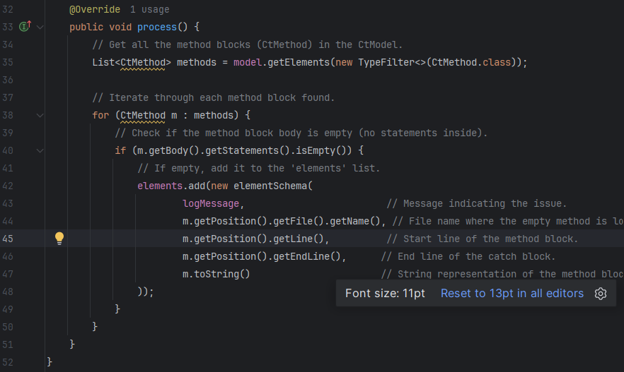
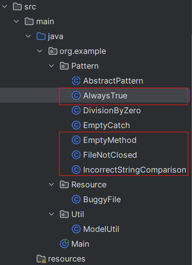
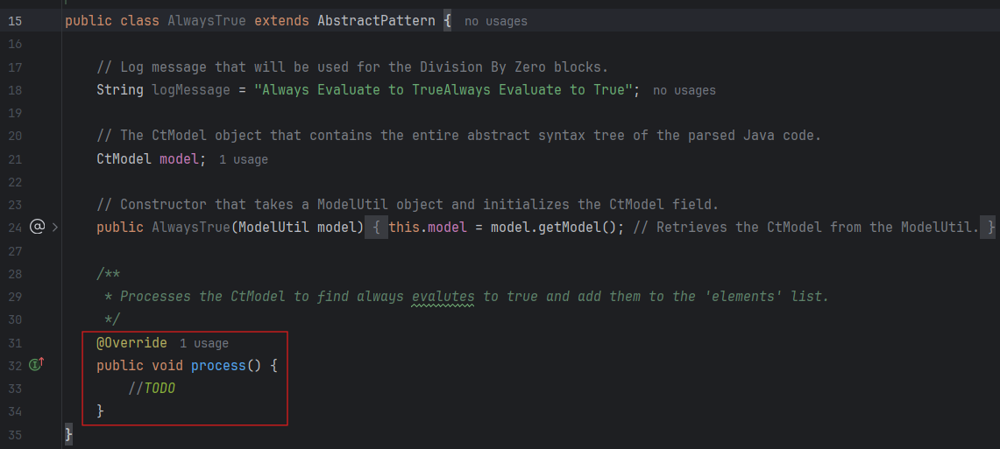
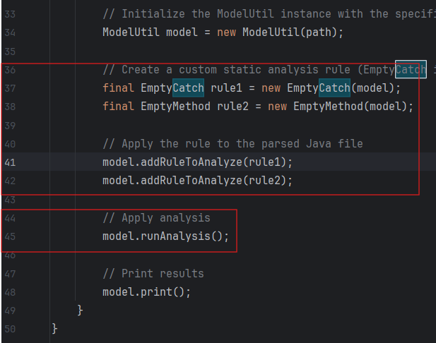
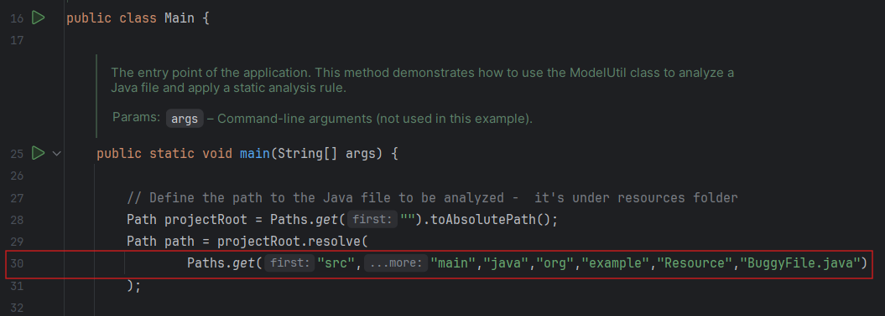

# SE333 · Static Analysis & Test Selection Assignment 2

Build a Spoon-based static analysis tool, then extend it to select regression tests and evaluate coverage.

| Assignment | Topic | Grade weight | Due date |
| :--- | :--- | :---: | :--- |
| Part 1| [Static Analysis](#assignment-3-static-analysis) | 10% | February 18, 2026 · 11:59 PM |
| Part 2 | [Static Test Selection](#assignment-4-static-test-selection) | 13% | Not specified in the source |

## Contents

- [Task 1: Static Analysis](#assignment-3-static-analysis)
  - [Setup and starter code](#a3-setup)
  - [Required detectors](#a3-detectors)
  - [Part 1: Seeded files](#a3-part1)
  - [Part 2: Real repository](#a3-part2)
  - [Grading and submission](#a3-submission)
- [Task 2: Static Test Selection](#assignment-4-static-test-selection)
  - [Environment setup](#a4-setup)
  - [Step 0: Configure the repository](#a4-step0)
  - [Step 1: Build the static mapping](#a4-step1)
  - [Step 2: Identify changes](#a4-step2)
  - [Step 3: Select tests](#a4-step3)
  - [Step 4: Measure coverage](#a4-step4)
  - [Deliverables](#a4-deliverables)


## Task 1: Static Analysis

> **Due:** February 18, 2026, at 11:59 PM · **Grade weight:** 10%

### Motivation

Static analysis examines source code without executing it. In software delivery pipelines, it typically runs during code review, pre-commit or pre-merge checks, and continuous integration (CI). It automates activities such as spotting risky patterns, identifying design smells, and detecting bug-prone code early. Tools provide fast, repeatable feedback that reduces the likelihood of risky changes reaching later pipeline stages.

In this lab, build a small static analysis tool using **Spoon**, an open-source Java framework for source-code analysis and transformation. Spoon builds a model of a codebase that can be queried programmatically.

For example, an empty-method detector queries the `CtModel` using `getElements` to retrieve all `CtMethod` elements, then checks `m.getBody().getStatements().isEmpty()`. An empty body is recorded as an issue with its source file and line range.



Example output:

```text
Detected: Empty Method Block at Line[8:10] in class BuggyFile.java
```

This identifies dead or incomplete code and its location.

<a id="a3-setup"></a>

### Starter Code

Accept the [GitHub Classroom assignment](https://classroom.github.com/a/RPWZOM_h).

| File | Purpose |
| :--- | :--- |
| `BuggyFile.java` | Production code intentionally seeded with common bug patterns and design flaws. |
| `ModelUtil.java` | Constructs the Spoon AST model of the codebase. |
| `EmptyCatch.java` | Fully working example detector. |
| `EmptyMethod.java` | Fully working example detector. |
| `Main.java` | CLI runner to extend when adding detectors. |

### Constraints

- Add new detector implementations only under `src/test/java/.../detectors/`.
- You may modify `Main.java` and `ModelUtil.java`.
- Do **not** modify `BuggyFile.java`; treat it as production code you do not control.

### Prerequisites and Environment

- Java 17 or newer.
- Maven 3.9 or newer.
- Git.
- Basic familiarity with JUnit 5.

<details>
<summary><strong>Maven dependencies</strong></summary>

```xml
<dependencies>
  <dependency>
    <groupId>fr.inria.gforge.spoon</groupId>
    <artifactId>spoon-core</artifactId>
    <version>10.4.2</version>
    <scope>test</scope>
  </dependency>
  <dependency>
    <groupId>org.junit.jupiter</groupId>
    <artifactId>junit-jupiter</artifactId>
    <version>5.10.2</version>
    <scope>test</scope>
  </dependency>
</dependencies>
```

</details>

<a id="a3-detectors"></a>

### Objective and Required Detectors

Use Spoon to analyze `BuggyFile.java` and detect common bug patterns and design issues. Implement detectors for **seven (7) issues in total**; some detectors may already be provided as examples.

> **Source ambiguity:** The PDF specifies seven issues, lists four patterns below, asks for two new rules, and provides both empty-catch and empty-method detectors. It does not clearly state which provided detectors count toward the seven.

#### 1. Always True Condition

Look for `CtIf` nodes whose condition always evaluates to true.

```java
public void method3() {
    if (true) {
    }
    int x = 4;
    if (x < 3) {
        x = x + 1;
    }
}
```

#### 2. Incorrect String Comparison

Identify binary comparisons (`==` or `!=`) between `String` values. Relevant Spoon elements include `CtBinaryOperator`, `CtExpression`, and type references to `java.lang.String`.

```java
public void method5() {
    String s1 = "test";
    String s2 = "test";
    boolean equal = (s1 == s2);
}
```

#### 3. File Not Closed

Detect file resources that are opened but never closed. Inspect `CtTry`, `CtCatch`, constructor calls such as `new FileReader(...)`, missing `close()` calls, and the absence of try-with-resources.

```java
public void method6_1() {
    try {
        FileReader fileReader = new FileReader("file.txt");
    } catch (FileNotFoundException e) {
        e.printStackTrace();
    }
}
```

#### 4. Division by Zero

Look for division operations whose divisor is zero. Focus on `CtBinaryOperator`, division operators (`/`), and literal values equal to `0`.

```java
public void method7_1() {
    int x = 10;
    x = x / 0;
}
```

#### 5. Two New Rules

Develop two additional rules based on real bugs. Identify each rule and cite the documentation it came from:

- [FindBugs](https://findbugs.sourceforge.net/)
- [SpotBugs](https://spotbugs.github.io/)
- “Security-related rules | SonarQube Cloud | Sonar Documentation” (named in the PDF without an extractable URL).

<a id="a3-part1"></a>

### Part 1: Build and Test on Seeded Files

1. **Understand the starter code.** Extend the project by adding detectors; do not rewrite it. The source highlights the intended extension area in red.

   

   

2. **Implement the static analysis tool.** Implement each rule as a separate detector. When an issue is detected, log relevant information, including the file name, line range, and code snippet or AST element.

3. **Update `Main.java`** to invoke the implemented rules.

   

**Hints:** Start with `EmptyMethod.java`. The detection structure is similar to `EmptyCatch`. Identify the appropriate Spoon AST node types, such as `CtMethod`, `CtCatch`, and `CtIf`.

<a id="a3-part2"></a>

### Part 2: Run on a Real Repository

1. **Select a target repository.** Choose a Java GitHub repository with no more than approximately **50,000 lines of code**.
2. **Execute the analysis.** Clone the repository and run `Main` on its `src` directory. Change the project path currently specified around line 30 to the cloned repository’s source directory.

   

3. **Sample and inspect results.** For each rule, select two findings, inspect the corresponding source code, and label each as a **True Positive (TP)** or **False Positive (FP)**.

   These intentionally simple rules may produce no findings for some patterns. A repository may already enforce similar checks. Clearly state any absence of findings in the write-up; you will not be penalized for it.

4. **Write the README analysis.** For each rule, include a brief description and two example findings with a code snippet or link to the relevant real-world source file, a TP/FP label, and an explanation.

Treat the lab as a mini static analysis framework: each detector is a rule, and the real-repository run evaluates how rules behave in practice. The goal is to understand how static analysis works, rather than perfect tool correctness. Real projects commonly use third-party tools such as SonarQube or CodeQL; understanding their mechanics helps you use them effectively.

<a id="a3-submission"></a>

### Grading and Submission

The source emphasizes that perfect tool correctness is not the end goal and that inability to implement some functionality is acceptable. Its grading introduction ends with an incomplete sentence; no missing rubric text has been inferred.

Submit **one ZIP file** containing:

- **Source code:** All required Spoon detectors under `src/test/java/.../detectors/`, updated `Main.java`, and `ModelUtil.java` if needed. `BuggyFile.java` must remain unchanged.
- **Analysis output on a real repository — 35 points:** Run `Main` on the cloned Java repository’s `src` directory (approximately 50K LOC or less), and include detection logs in `.txt` format.
- **README report — 35 points:** Include the sections below.

> The PDF explicitly gives 35 points each for the analysis output and README report. It does not specify a point value for the source-code item.

#### Required README Sections

1. **Name and Student ID:** Include both so the instructor can associate the GitHub repository with you.
2. **Rule Specifications:** For every detector, describe what it detects and which Spoon AST nodes it uses.
3. **Real-World Findings Review:** For every rule, provide two findings, a code snippet or source-file link, a TP/FP classification, and a short justification. Explain when findings are absent.

The ZIP must contain source code, the log file, and `README.md`.

---

## Task 2: Static Test Selection

> **Grade weight:** 13%

### Goals

- Understand how static call graphs approximate which tests are affected by a code change.
- Use dynamic coverage (JaCoCo) to measure which tests execute changed code.
- Compare static predictions with dynamic measurements.
- Calculate precision for regression test selection.
- Analyze uncovered changes and interpret false positives and false negatives.

### Background

Rerunning all tests after every code change can be wasteful. Test selection aims to run tests relevant to modified code.

| Approach | Basis | Strength | Limitation |
| :--- | :--- |---|---|
| Static analysis | Builds a call graph between tests and source code. | Fast; no runtime overhead. | Conservative; may include tests that could execute a change but do not actually do so. |
| Dynamic analysis | Uses runtime coverage instrumentation. | Precise; captures real execution paths. | Slower; requires test execution and data collection. |

Use both approaches on a real codebase and compare their outcomes. Explain why they differ, particularly when coverage reports omit changed files.

<a id="a4-setup"></a>

### Environment Setup

1. Clone the project:

   ```sh
   git clone https://github.com/spring-projects/spring-petclinic
   ```

2. Verify that it builds and runs tests:

   ```sh
   mvn clean test
   ```

3. The assignment states that JaCoCo is already configured in `pom.xml`. You may need to run `jacoco:report` to generate the HTML report. Its stated location is:

   ```text
   target/site/jacoco/index.html
   ```

<a id="a4-step0"></a>

### Step 0: Repository of Analysis

In `Main.java`, around line 19, update the repository reference to your local project directory rather than the starter default:

```java
Path path = Paths.get(); // TODO: change this to your repository path
```

<a id="a4-step1"></a>

### Step 1: Static Test Selection

Build a static mapping between test methods and source classes using the Inria Spoon API. This approximates which tests could be affected by changes to classes or methods.

#### Warm-up Question

Given:

```text
ClassA#MethodA -> ClassB#MethodC
TestClassA#TestMethodB -> ClassA#MethodA
TestClassC#TestMethodC -> ClassC#MethodC
```

If the latest commit changes `ClassC`, which tests should rerun?

#### Parse and Build the Call Graph

1. Use the static analysis tool from Task 1 to traverse the repository and collect class-level dependencies.
2. Parse all source files in `src/main/java` and `src/test/java`.
3. For each method invocation (`CtInvocation` in Spoon), record:

   ```text
   <callerClass>#<callerMethod> -> <calleeClass>#<calleeMethod>
   ```

Example graph:

```text
ClassA#methodA -> ClassB#methodC
TestClassA#testMethodB -> ClassA#methodA
TestClassC#testMethodC -> ClassC#methodC
```

#### Derive the Test-to-Source Mapping

Map each test method to the classes it depends on, directly or transitively:

```text
TestClassA#testMethodB, [ClassA, ClassB]
TestClassC#testMethodC, [ClassC]
```

Tips:

- Identify tests using `@Test`.
- Follow invocations recursively.
- Inspect `CtInvocation<?>` nodes and use `invocation.getExecutable().getDeclaringType()` to identify the target class.
- Use a `Map<String, Set<String>>` whose key is a test method and whose value is its set of directly or indirectly referenced source classes.

<a id="a4-step2"></a>

### Step 2: Identify Code Changes (Δ)

Automatically collect changed files between two commits using **JGit**, the Java API for Git. These files represent the changes targeted by regression test selection.

#### Warm-up Question

Suppose the diff identifies:

```text
OwnerController.java
WebConfiguration.java
Vet.java
```

The test-to-source mapping identifies:

```text
OwnerControllerTests#testProcessFindFormSuccess
VetControllerTests#showVetList
```

Which tests should run? Which changed file remains untested?

#### What Counts as Changed?

A file is changed if it was **modified, added, or renamed** between two commits and is a `.java` file under `src/main/java/`.

Produce a set such as:

```text
Changed = {
  org/springframework/samples/petclinic/owner/OwnerController.java,
  org/springframework/samples/petclinic/model/Person.java,
  ...
}
```

#### JGit Starter Code

Compare the current commit with the previous commit. The assignment states that this component is provided.

<details>
<summary><strong>JGit starter example</strong></summary>

```java
import org.eclipse.jgit.api.Git;
import org.eclipse.jgit.diff.DiffEntry;
import org.eclipse.jgit.lib.Repository;
import org.eclipse.jgit.storage.file.FileRepositoryBuilder;
import java.io.File;
import java.util.List;
import java.util.stream.Collectors;

public class GitDiffUtil {
    // Compare the old and new commits to identify code changes.
    public static List<String> getChangedFiles(
            String repoPath, String oldCommit, String newCommit) throws Exception {
        Repository repository = new FileRepositoryBuilder()
                .setGitDir(new File(repoPath, ".git"))
                .build();

        try (Git git = new Git(repository)) {
            List<DiffEntry> diff = git.diff()
                    .setOldTree(Utils.prepareTreeParser(repository, oldCommit))
                    .setNewTree(Utils.prepareTreeParser(repository, newCommit))
                    .call();

            return diff.stream()
                    .filter(d -> d.getNewPath().endsWith(".java"))
                    .map(DiffEntry::getNewPath)
                    .collect(Collectors.toList());
        }
    }
}
```

</details>

> The example filters by `.java` extension only; the written requirements also restrict changed files to `src/main/java/`. `Utils.prepareTreeParser` is referenced by the starter example but is not defined in the PDF.

<a id="a4-step3"></a>

### Step 3: Select Tests for Code Changes

Using the static test-to-source mapping and JGit’s changed-file set:

1. Load the `Map<String, Set<String>>` mapping.
2. Load the list of changed files.
3. Find intersections to identify tests that should rerun.

You may implement this as you prefer. JaCoCo XML and Spoon use different naming conventions; you may need an adapter to normalize them.

<a id="a4-step4"></a>

### Step 4: Dynamic Coverage for Selected Tests

1. Automatically run the following command from Java to collect coverage for only the statically selected tests:

   ```sh
   mvn test -Dtest=<comma-separated-test-list> jacoco:report
   ```

   The assignment provides `TestExecutor`. It is written for Windows; macOS may require adjustments. Invoke it using:

   ```java
   TestExecutor.runTestsInRepo(
       "C:/my/repo", List.of("PathUtilTest", "TestMappingTest"));
   ```

2. Parse the coverage report at `target/site/jacoco/jacoco.xml`. Use XPath or another XML parser to extract covered class names. The suggested dependency is:

   ```xml
   <dependency>
     <groupId>com.fasterxml.jackson.dataformat</groupId>
     <artifactId>jackson-dataformat-xml</artifactId>
     <version>2.17.1</version>
   </dependency>
   ```

3. Compare the changed-file set from Git with the covered-file set from JaCoCo. Compute `Changed ∩ Covered`.
4. Compute precision:

   ```text
   Precision = |Changed ∩ Covered| / |Covered|
   ```

   Precision measures how many files executed by the selected tests were part of the recent change.

   - `Changed`: set of modified files.
   - `Covered`: files executed by selected tests, obtained from JaCoCo.
   - `∩`: intersection; files both changed and executed.

5. Answer:

   - Report your computed precision. Based on it, how good is your tool at predicting which tests to run?
   - Why might some changed files not appear in the JaCoCo report? Consider configuration classes, unused code, and paths not exercised by tests.

<a id="a4-deliverables"></a>

### Deliverables

Write sections 1–6 below in **`readme.md` at the root of your codebase**, and submit the codebase as item 7.

| Section | Required content | Screenshot requirement |
| :--- | :--- |---|
| 1. Static Call Graph | Show the tool’s mapping between tests and source classes, using console output or a CSV extract. | Call-graph summary or mapping file. |
| 2. Code Changes (Δ) | List files detected as changed between two commits. | JGit terminal output or printed changed-file list. |
| 3. Selected Tests | Show tests automatically selected by intersecting the test-to-source mapping with changed files. | Console or log output showing selected tests. |
| 4. Dynamic Coverage Report | Demonstrate that only selected tests ran and generated JaCoCo data. | JaCoCo `index.html` showing covered classes and percentages. |
| 5. Precision | Present computed metrics, explain their meaning, and interpret their quality. | Screenshot or table showing computed values. |
| 6. Warm-up Questions | Answer all warm-up questions from the assignment. | Brief written reflection; no screenshot needed. |
| 7. Codebase | Submit your code in addition to the screenshots. | Code must run without issues. |
